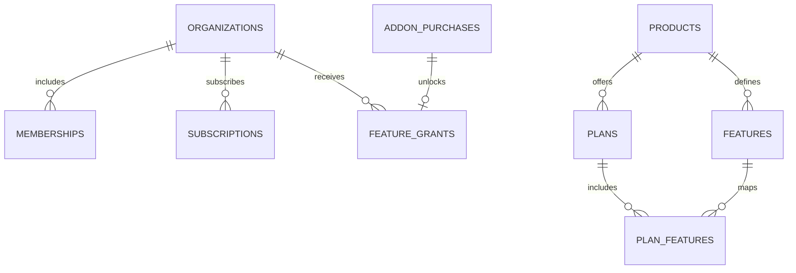

# NOMAD Supabase Blueprints

여러 제품에서 재사용하는 Supabase DB 설계와 SQL입니다. GitHub에는 마이그레이션, 합성 테스트 데이터, 복구 절차를 보관합니다. 고객 데이터 백업은 별도 저장소에서 운영합니다.

## 시작하기

| 파일 | 사용 목적 |
|---|---|
| `supabase/migrations/20261112000100_nomad_core.sql` | 공통 계정 프로필·업체·멤버십·A/B/C 플랜·단품 이용권 |
| `supabase/migrations/20261112000200_contentflow_example.sql` | ContentFlow 실습용 제품·플랜·업무 테이블 및 RLS |
| `tests/tenant_access.sql` | 합성 업체 3곳으로 접근·기능 잠금 검증 |
| [설치와 통합](docs/INTEGRATION.md) | 기존 제품에 가져오는 방법, 기능 이용권 계약 |
| [백업과 복구](docs/BACKUP_RESTORE.md) | 스키마 재현과 데이터 복구의 절차 |

ContentFlow의 기존 운영 스키마와 구분하기 위해 예시 제품에는 `contentflow_example`이라는 키를 사용합니다. 공통 마이그레이션을 먼저 적용하고, 기존 제품을 연결할 때는 실습 마이그레이션 대신 제품 전용 마이그레이션을 작성합니다.

## 제품과 플랜

| 기능 | C 기본 | B 중간 | A 최상위 | 단품 |
|---|---|---|---|---|
| 게시물 관리·기본 통계 | 열림 | 열림 | 열림 | — |
| 예약 발행 | 잠김 | 열림 | 열림 | — |
| 고급 분석 | 잠김 | 잠김 | 열림 | 가능 |
| 승인 워크플로 | 잠김 | 잠김 | 열림 | — |

업체에 플랜이 부여됩니다. 업체 직원의 권한은 그 업체 멤버십에 기록합니다. 같은 업체도 제품마다 별도 구독을 보유할 수 있고, C 업체의 고급 분석 구매는 해당 제품의 기능 하나만 엽니다.

## 범위

SQL은 업체 격리, 기능 조회, 단품 활성 여부와 ContentFlow 예시의 DB 접근을 구현합니다. 제품 대시보드 UI, 결제사 연동, 사용자 초대·업체 생성 API, 운영자 대시보드 API는 제품에서 연결합니다. 배포 전에 실제 로컬 Supabase에서 Data API, 인증 세션, 운영 백업 복구를 검증합니다.
