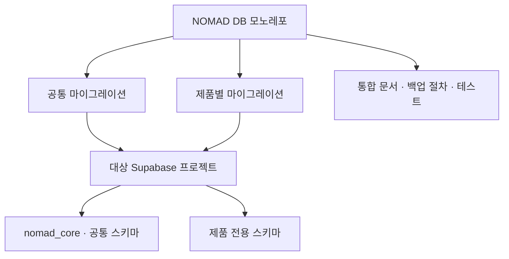
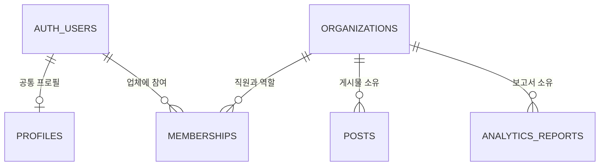
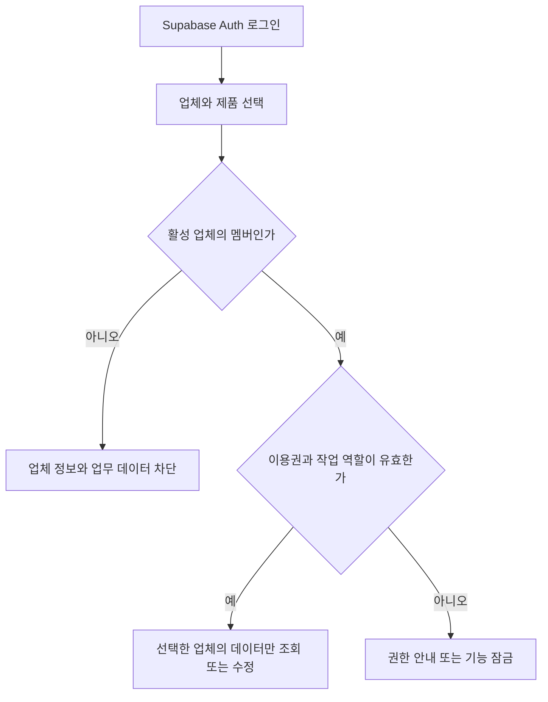
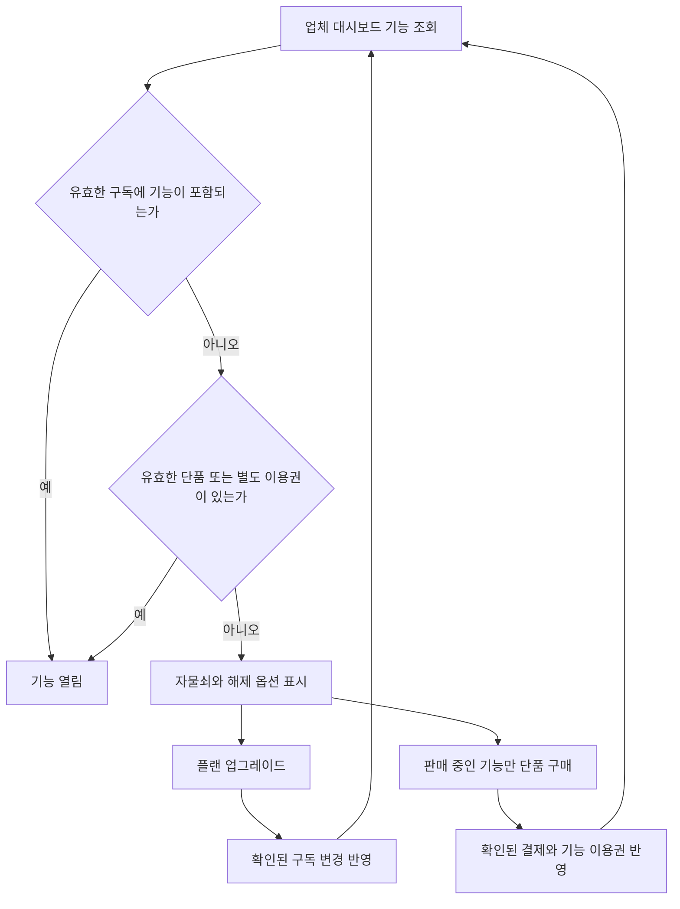

# NOMAD Supabase Blueprints

여러 제품에서 재사용하는 Supabase DB 설계와 SQL입니다. GitHub에는 마이그레이션, 합성 테스트 데이터, 복구 절차를 보관합니다. 고객 데이터 백업은 별도 저장소에서 운영합니다.

## 시작하기

| 파일 | 사용 목적 |
|---|---|
| `supabase/migrations/20261112000100_nomad_core.sql` | 공통 계정 프로필·업체·멤버십·A/B/C 플랜·단품 이용권 |
| `supabase/migrations/20261112000200_contentflow_example.sql` | ContentFlow 실습용 제품·플랜·업무 테이블 및 RLS |
| `supabase/migrations/20261114000100_nomad_core_accounts.sql` | 가입 트리거·1인/팀 조직·초대·조직 크레딧 원장 |
| `supabase/migrations/20261115000101~111_<서비스>.sql` | 서비스 스키마 11개 (조직형 7 · 개인형 4, 청사진에서 확정) |
| `tests/tenant_access.sql` | 합성 업체 3곳으로 접근·기능 잠금 검증 |
| `tests/accounts.sql` | 가입·초대·좌석 한도·크레딧 차감 검증 |
| `tests/services_access.sql` | 서비스 11개의 RLS·권한·업체/사용자 격리 검증 |
| [설치와 통합](docs/INTEGRATION.md) | 기존 제품에 가져오는 방법, 기능 이용권 계약 |
| [백업과 복구](docs/BACKUP_RESTORE.md) | 스키마 재현과 데이터 복구의 절차 |
| [`blueprints/`](blueprints/README.md) | 서비스별 DB 청사진 (조직형 7 · 개인형 4 확정, 격리형 2 초안) |
| [`docs/design/`](docs/design/00-overview/principles.md) | 서비스 DB 설계 기획 (원칙 · 구조 · 규칙) |

ContentFlow의 기존 운영 스키마와 구분하기 위해 예시 제품에는 `contentflow_example`이라는 키를 사용합니다. 공통 마이그레이션을 먼저 적용하고, 기존 제품을 연결할 때는 실습 마이그레이션 대신 제품 전용 마이그레이션을 작성합니다.

## 모노레포와 공유 DB 구조

이 저장소는 여러 제품에서 가져다 쓸 **공통 DB 마이그레이션과 제품별 예시를 한곳에서 관리하는 DB 모노레포**입니다. ContentFlow·HumScore·FLORA의 앱 코드는 각 제품 레포에서 관리할 수 있습니다. **코드와 SQL을 어디에 보관할지**는 저장소의 결정이고, **어떤 제품이 같은 Supabase 프로젝트를 쓸지**는 배포 환경의 결정입니다.

| 계층 | 관리하는 내용 | 예시 |
| --- | --- | --- |
| GitHub 저장소 | DB 구조를 재현하는 SQL과 검증 절차 | `supabase/migrations/`, `tests/`, `docs/` |
| Supabase 프로젝트 | 실제 DB가 배포되는 환경 | 공유 개발 프로젝트, 제품 전용 운영 프로젝트, 강의 실습 프로젝트 |
| 공통 스키마 | 업체·멤버십·제품·구독·이용권 | `nomad_core.organizations`, `nomad_core.subscriptions` |
| 제품 스키마 | 제품 업무와 관련된 데이터 | `nomad_contentflow_example.posts`, `nomad_contentflow_example.analytics_reports` |

공유 개발 DB에는 공통 스키마를 한 번 적용한 뒤 연결할 제품의 스키마를 각각 추가합니다. ContentFlow 실습용 DB를 따로 만들 때는 같은 공통 마이그레이션과 ContentFlow 예시 마이그레이션만 빈 프로젝트에 적용합니다. HumScore·FLORA에 연결하려면 각 제품용 마이그레이션과 기존 계정·데이터의 매핑이 필요합니다. [설치와 통합](docs/INTEGRATION.md)

## 멀티테넌트 데이터 구조

**테넌트는 서비스를 이용하는 업체 한 곳**입니다. 직원은 개인 계정으로 로그인하고, `memberships`에 등록된 업체와 역할에 따라 일합니다. 한 계정이 여러 업체에 속할 수 있고 업체마다 역할이 다를 수 있습니다. 각 게시물과 분석 보고서에는 소유 업체를 나타내는 `organization_id`가 들어갑니다.

| 구분 | 기준 | 동작 예시 |
| --- | --- | --- |
| 사용자 계정 | `auth.users.id` | 이메일 로그인으로 사용자를 확인 |
| 업체·테넌트 | `organizations.id` | 새봄기획과 한울미디어의 업무 데이터가 각각의 업체 ID를 가짐 |
| 업체 멤버십 | `memberships`의 업체 ID·사용자 ID·역할 | 한 계정이 새봄기획에서는 관리자, 한울미디어에서는 편집자 |
| 제품별 구독 | `subscriptions`의 업체 ID·제품 코드 | 새봄기획은 ContentFlow에서 C 플랜, 다른 제품에서는 별도 플랜 사용 가능 |
| 운영 관리자 | `platform_admins`의 운영·결제 권한 범위 | 운영자 화면에 쓰는 권한 원본. 이 레코드만으로 고객 업무 데이터 접근이 허용되지는 않음 |

예를 들어 새봄기획과 한울미디어가 모두 A 플랜이라도 새봄기획 직원은 자기 업체 데이터만 조회할 수 있습니다. 새봄기획이 C에서 A로 바뀌면 **구독 플랜만 변경**되며, 업체 ID와 기존 게시물은 그대로 유지됩니다.

### 로그인부터 업무 데이터 접근까지

1. `organization_role()`은 로그인한 사용자와 선택한 업체의 멤버십을 확인합니다. 비활성 업체와 비회원에게는 역할을 반환하지 않습니다.
2. `public.nomad_dashboard_features()`는 제품 기능 목록과 잠금 상태를 반환합니다. 화면은 잠긴 기능의 이름과 해제 방법을 표시할 수 있습니다.
3. 데이터 요청에서도 **행 수준 보안 정책(RLS)**을 적용합니다. 실습 스키마에서 게시물 조회는 업체 멤버십과 게시물 기능 이용권을, 추가·수정은 편집 가능한 역할도 확인합니다. 고급 분석 보고서는 해당 업체의 고급 분석 이용권이 있을 때 조회할 수 있습니다.
4. 운영 관리자 화면은 앱에서 별도로 연결합니다. 업체 직원의 `admin` 역할은 해당 업체 안에서 적용됩니다.

## 제품과 플랜

| 기능 | C 기본 | B 중간 | A 최상위 | 단품 |
|---|---|---|---|---|
| 게시물 관리·기본 통계 | 열림 | 열림 | 열림 | — |
| 예약 발행 | 잠김 | 열림 | 열림 | — |
| 고급 분석 | 잠김 | 잠김 | 열림 | 가능 |
| 승인 워크플로 | 잠김 | 잠김 | 열림 | — |

업체에 플랜이 부여됩니다. 업체 직원의 권한은 그 업체 멤버십에 기록합니다. 같은 업체도 제품마다 별도 구독을 보유할 수 있고, C 업체의 고급 분석 구매는 해당 제품의 기능 하나만 엽니다.

### 플랜과 단품 구매로 기능이 열리는 방식

| 판단에 필요한 데이터 | 관련 테이블 |
| --- | --- |
| 어느 제품의 어떤 플랜을 쓰는가 | `products`, `plans`, `subscriptions` |
| 플랜에 해당 기능이 포함되는가 | `features`, `plan_features` |
| 잠긴 기능을 단품으로 살 수 있는가 | `addon_products`의 판매 상태 |
| 단품 결제가 유효하고 이용권 기간이 남아 있는가 | `addon_purchases`, `feature_grants` |

| 대시보드 응답 | 화면 처리 |
| --- | --- |
| `unlocked = true` | 기능을 열고 실제 작업의 역할 권한을 확인 |
| `unlocked = false` + `upgrade_to` | 자물쇠와 해당 기능을 포함한 상위 플랜 안내 |
| `unlocked = false` + `addon_sku` | 자물쇠와 단품 구매 옵션 표시 |
| `can_purchase = false` | 결제 대신 업체 담당자에게 요청하는 안내 표시 |

예를 들어 **C 플랜 업체가 고급 분석만 구매하면 고급 분석 카드와 해당 보고서 조회가 열립니다.** 예약 발행·승인 워크플로는 C 플랜 상태에서 계속 잠겨 있습니다. 환불되거나 단품 이용권이 만료되면, 유효한 다른 이용권이나 포함 플랜이 없는 경우 다시 잠깁니다. A 플랜의 읽기 전용 직원에게는 기능이 열려도 게시물 편집이나 결제 권한이 부여되지 않습니다.

### 실습에서 확인할 시나리오

- A·B·C 업체의 기본 기능이 플랜표대로 열리는지 확인합니다.
- A 업체 사용자가 B·C 업체의 게시물이나 대시보드 카탈로그를 조회할 수 없는지 확인합니다.
- C 업체가 고급 분석을 단품 구매하면 그 기능만 열리고, 환불하면 다시 잠기는지 확인합니다.
- C 업체가 A로 업그레이드하면 상위 기능이 열리고 기존 게시물과 업체 ID가 유지되는지 확인합니다.
- 읽기 전용 사용자가 게시물 작성과 구매 권한을 갖지 않는지 확인합니다.

실행용 검증은 [테넌트 접근 테스트](tests/tenant_access.sql)에 있습니다.

## 범위

SQL은 업체 격리, 기능 조회, 단품 활성 여부와 ContentFlow 예시의 DB 접근을 구현합니다. 제품 대시보드 UI, 결제사 연동, 사용자 초대·업체 생성 API, 운영자 대시보드 API는 제품에서 연결합니다. 배포 전에 실제 로컬 Supabase에서 Data API, 인증 세션, 운영 백업 복구를 검증합니다.
