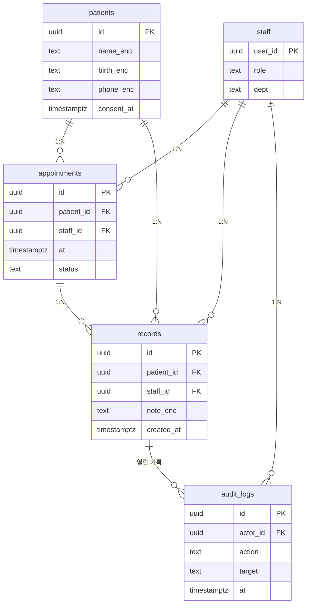

# hospital · 별도 Supabase 프로젝트

- MEDIC-CRM · 공용 프로젝트와 분리
- 기관 1곳 납품이라 tenant_id 없이 역할(role) 기준

| 항목 | 값 |
|---|---|
| slug | `hospital` |
| 유형 | `isolated` |
| DB | Supabase 프로젝트 B (격리) |

## ER 다이어그램

## 테이블

| 테이블 | 컬럼 수 |
|---|---|
| `patients` | 5 |
| `appointments` | 5 |
| `staff` | 3 |
| `records` | 5 |
| `audit_logs` | 5 |

초안 SQL: [`schema.draft.sql`](./schema.draft.sql)

## 접근 규칙

- role 기준: 의사·간호는 담당 환자 기록, 접수는 예약만
- 민감 컬럼은 암호화하고 열람·수정은 audit_logs에 남김
- 여러 병원이 구독하는 SaaS가 되면 clinic_id를 추가해 조직형으로 전환
- 공용 프로젝트와 분리되어 외래키·조인 없음

> 이 문서는 제안 초안입니다. 실제 레포 스키마와 대조 후 확정하세요.
