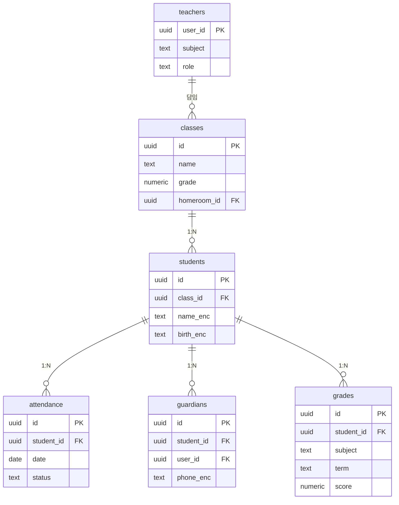

# school · 별도 Supabase 프로젝트

- school-management-system · 공용 프로젝트와 분리
- 학교 1곳 납품이라 tenant_id 없이 역할(role) 기준

| 항목 | 값 |
|---|---|
| slug | `school` |
| 유형 | `isolated` |
| DB | Supabase 프로젝트 B (격리) |

## ER 다이어그램

## 테이블

| 테이블 | 컬럼 수 |
|---|---|
| `classes` | 4 |
| `students` | 4 |
| `attendance` | 4 |
| `teachers` | 3 |
| `guardians` | 4 |
| `grades` | 5 |

초안 SQL: [`schema.draft.sql`](./schema.draft.sql)

## 접근 규칙

- 교사: 담당 학급 학생만 · 학부모: 본인 자녀만
- 학생 개인정보는 암호화, 성적 수정 기록은 별도 로그
- 여러 학교가 구독하는 SaaS가 되면 school_id를 추가해 조직형으로 전환

> 이 문서는 제안 초안입니다. 실제 레포 스키마와 대조 후 확정하세요.
