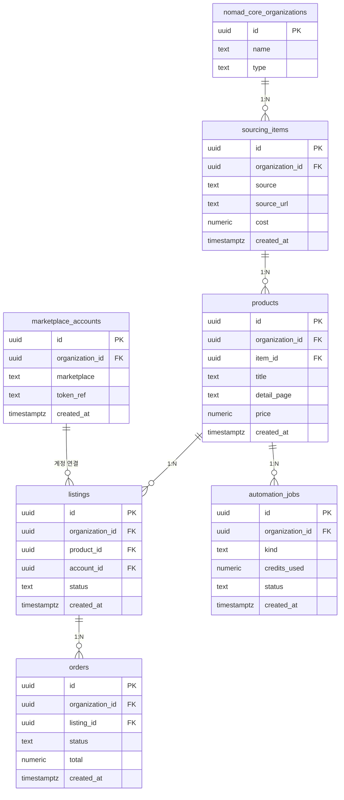

# commerce · 조직형

- tenant = 셀러 계정 (개인 셀러도 1인 조직)
- 구매대행·역직구·SellingStudio를 한 구조로 묶는 안

| 항목 | 값 |
|---|---|
| slug | `commerce` |
| 유형 | `org` |
| DB | Supabase 프로젝트 A |

## ER 다이어그램

## 테이블

| 테이블 | 컬럼 수 |
|---|---|
| `sourcing_items` | 6 |
| `products` | 7 |
| `listings` | 6 |
| `automation_jobs` | 6 |
| `marketplace_accounts` | 5 |
| `orders` | 6 |

초안 SQL: [`schema.draft.sql`](./schema.draft.sql)

## 역할별 화면

- owner  마켓 계정 연결, 결제·크레딧 관리
- operator  상품 등록과 주문 처리
- sourcer  소싱 후보 수집·가공만 담당
- 도메인 테이블은 globalseller 스키마, 핵심 테이블은 core(public)에 배치
- RLS: org_id가 내가 속한 조직인 행만 읽고 씀

> 이 문서는 제안 초안입니다. 실제 레포 스키마와 대조 후 확정하세요.
