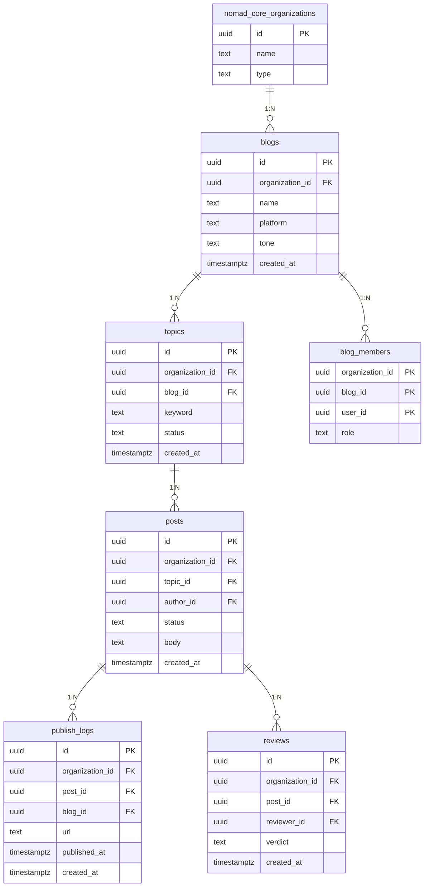

# contentflow · 조직형

- tenant = 블로그를 함께 운영하는 팀·에이전시
- 개인 가입자는 1인 조직으로 자동 생성

| 항목 | 값 |
|---|---|
| slug | `contentflow` |
| 유형 | `org` |
| DB | Supabase 프로젝트 A |

## ER 다이어그램

## 테이블

| 테이블 | 컬럼 수 |
|---|---|
| `blogs` | 6 |
| `topics` | 6 |
| `posts` | 7 |
| `blog_members` | 4 |
| `publish_logs` | 7 |
| `reviews` | 6 |

초안 SQL: [`schema.draft.sql`](./schema.draft.sql)

## 역할별 화면

- owner · admin  전체 블로그, 팀원, 결제 관리
- editor  검수 대기 글을 승인·반려
- writer  내가 맡은 블로그의 글 작성
- viewer  발행 결과와 성과만 열람
- RLS: org_id가 내가 속한 조직인 행만 읽고 씀

> 이 문서는 제안 초안입니다. 실제 레포 스키마와 대조 후 확정하세요.
