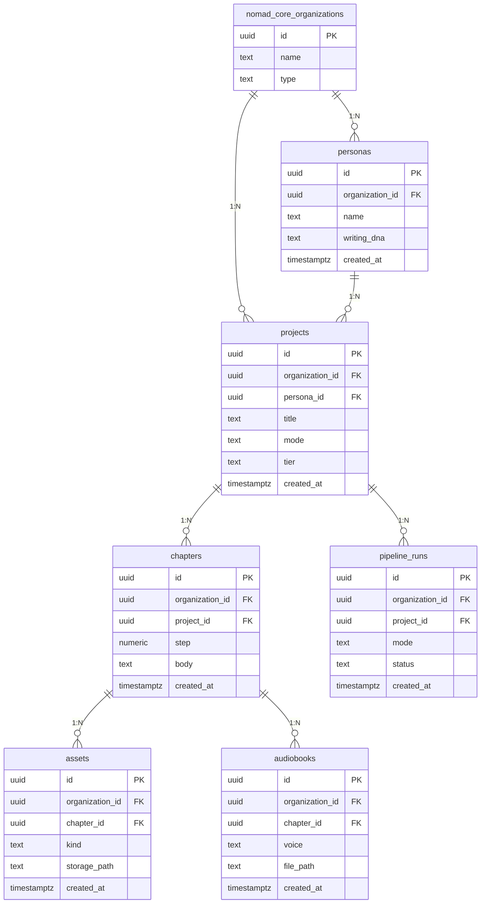

# flora · 조직형

- tenant = 책을 함께 만드는 1인 출판사·팀
- 10단계 파이프라인, 책 제작 모드 4종

| 항목 | 값 |
|---|---|
| slug | `flora` |
| 유형 | `org` |
| DB | Supabase 프로젝트 A |

## ER 다이어그램

## 테이블

| 테이블 | 컬럼 수 |
|---|---|
| `projects` | 7 |
| `chapters` | 6 |
| `assets` | 6 |
| `personas` | 5 |
| `pipeline_runs` | 6 |
| `audiobooks` | 6 |

초안 SQL: [`schema.draft.sql`](./schema.draft.sql)

## 역할별 화면

- owner · admin  요금제, 팀원, 페르소나(Taste) 관리
- editor  원고 검수와 챕터 수정
- writer  배정된 책 프로젝트 집필
- Taste는 프로젝트 생성 시 고정 · 크레딧은 nomad_core.credit_ledger (반영 후보, 미구현)에서 차감
- RLS: org_id가 내가 속한 조직인 행만 읽고 씀

> 이 문서는 제안 초안입니다. 실제 레포 스키마와 대조 후 확정하세요.
