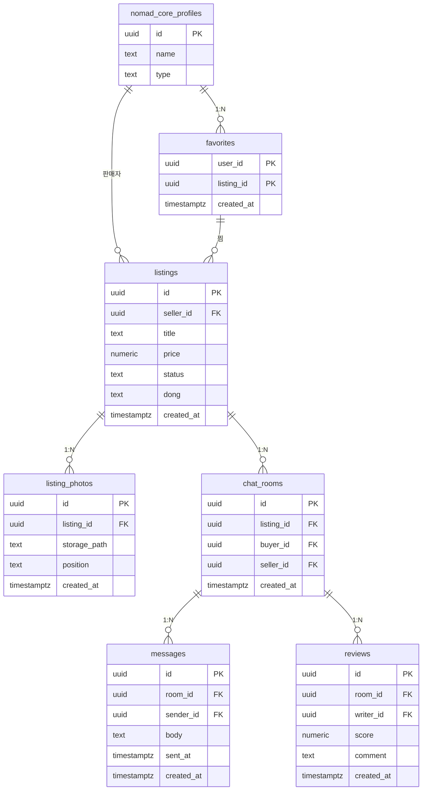

# jangter · 개인형 (마켓플레이스)

- 소유자 = 판매자, 접근 = 거래 당사자
- 조직 개념 없음

| 항목 | 값 |
|---|---|
| slug | `jangter` |
| 유형 | `user` |
| DB | Supabase 프로젝트 A |

## ER 다이어그램

## 테이블

| 테이블 | 컬럼 수 |
|---|---|
| `listings` | 7 |
| `listing_photos` | 5 |
| `favorites` | 3 |
| `chat_rooms` | 5 |
| `messages` | 6 |
| `reviews` | 6 |

초안 SQL: [`schema.draft.sql`](./schema.draft.sql)

## 접근 규칙

- 상품: 누구나 열람 · 수정은 seller_id = 나
- 채팅·메시지: 거래 당사자(구매자·판매자)만
- 찜: 본인 것만 · 동네(dong) 값으로 지역 필터

> 이 문서는 제안 초안입니다. 실제 레포 스키마와 대조 후 확정하세요.
