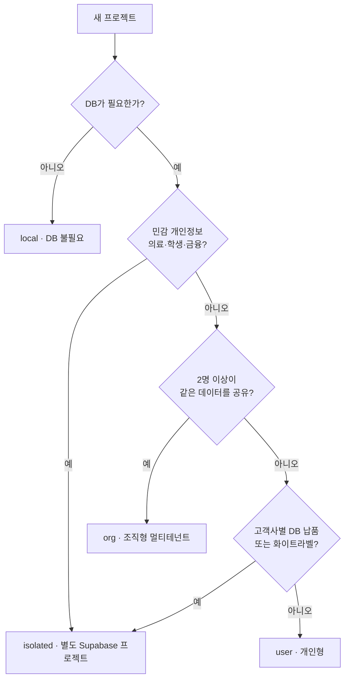

# 프로젝트 유형 선택 흐름

## 표로 보기
| 질문 | 예 → | 아니오 → |
|---|---|---|
| DB가 필요한가 | 다음 질문 | **local** |
| 의료·학생 등 민감정보인가 | **isolated** | 다음 질문 |
| 2명 이상이 데이터를 공유하는가 | **org** | 다음 질문 |
| 고객사별로 DB를 따로 납품하는가 | **isolated** | **user** |

## 전환 경로
- user → org: 팀 기능이 생길 때. 소유자 컬럼을 `org_id`로 확장 (humscore는 `workspace_id` NULL 컬럼을 미리 둠).
- isolated → org: 병원이 여러 곳 구독하는 SaaS가 되면 `clinic_id` 추가.
- local → org: 판매·구독 서비스가 되면 (예: Motion → SceneFlow 연결).
