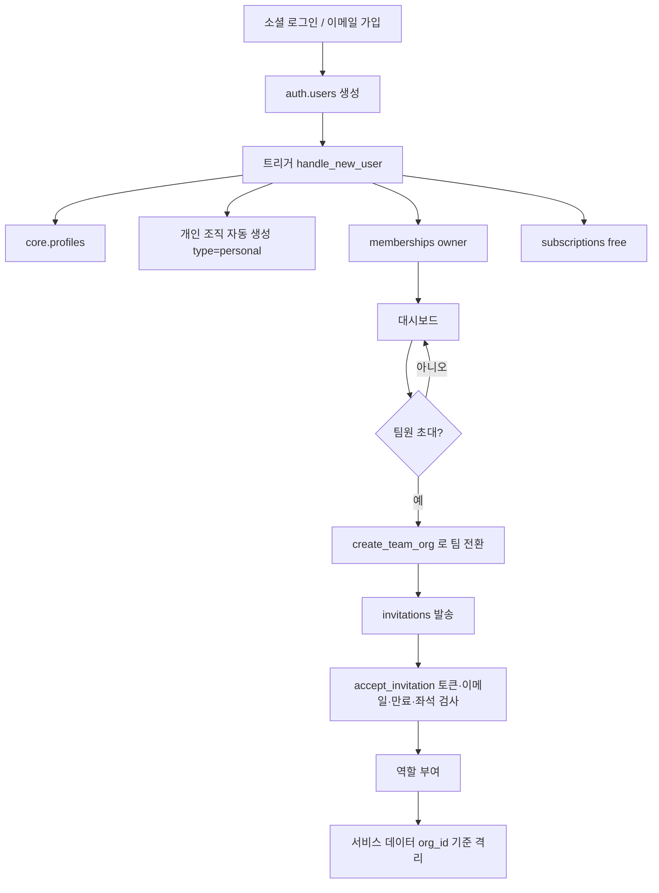

# 가입 · 조직 · 초대 흐름

## 가입 화면
- 카드 2개("개인으로 시작" / "팀·기업으로 시작")는 **UI 선택일 뿐** DB는 동일하다.
- 개인: 소셜 로그인 → 자동으로 1인 조직.
- 팀: 가입 후 `create_team_org()` 호출 → 회사명 입력 → 초대.

## 초대 규칙
- 초대는 이메일 기준. 수락 시 로그인 이메일과 일치해야 한다.
- 만료 7일(기본). 만료 후 재발송.
- 좌석 한도는 **초대 시점**에 검사한다 (viewer 제외).
- 계정 공유(1개 ID로 여러 명) 방식은 쓰지 않는다. 사람마다 계정을 가진다.
