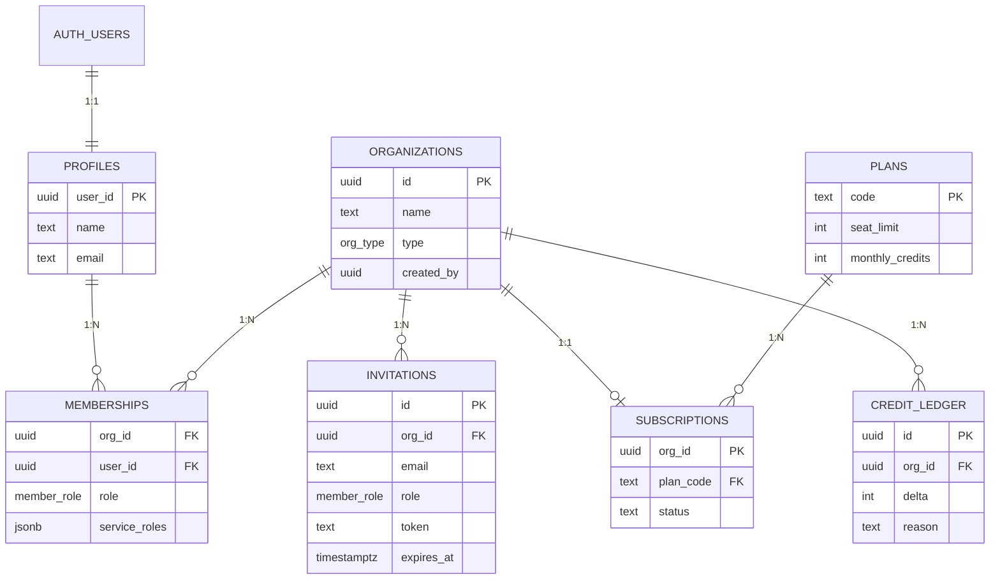

# core 스키마 설계

모든 서비스가 공유하는 계정 계층. 서비스 스키마는 `core`만 참조한다.

## 테이블 요약
| 테이블 | 역할 | 쓰기 권한 |
|---|---|---|
| `core.profiles` | auth.users 1:1 프로필 | 본인 |
| `core.organizations` | 개인/팀 조직 | 트리거·`create_team_org()` |
| `core.memberships` | 조직-사용자-역할 | owner/admin |
| `core.invitations` | 이메일 초대 | owner/admin |
| `core.plans` | 요금제 정의 | service_role |
| `core.subscriptions` | 조직별 구독 | service_role |
| `core.credit_ledger` | 크레딧 원장 | `spend_credits()` / service_role |

## 헬퍼 함수 (security definer)
- `core.is_member(org uuid) → boolean`
- `core.has_role(org uuid, roles core.member_role[]) → boolean`
- `core.shares_org_with(uid uuid) → boolean`
- `core.create_team_org(name text) → uuid`
- `core.accept_invitation(token text) → uuid`
- `core.spend_credits(org uuid, amount int, reason text) → int`

SQL은 `core-proposal/sql/0001~0006`에 있다.
