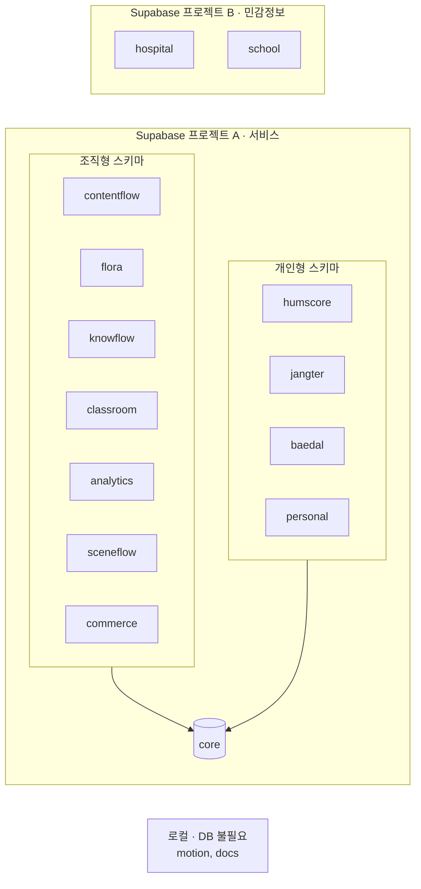

# Supabase 배치

## 규칙
1. 서비스 스키마끼리 FK·조인 금지. `core`만 참조.
2. 프로젝트 B는 A와 계정도 분리한다. (병원·학교는 자체 인증)
3. 서비스가 커지면 스키마 단위로 별도 프로젝트로 분리한다. 위 규칙 덕분에 `core` 참조만 API로 바꾸면 된다.
4. 프로젝트 A는 Free/Pro로 시작, B는 Pro + 백업 + 감사 로그 전제.

## 비용 관점 (MVP)
- A 1개 + B 0개로 시작 가능 (병원·학교는 계약 확정 후 B 생성)
- 서비스별 프로젝트 15개 대신 스키마 분리로 고정비 절감
