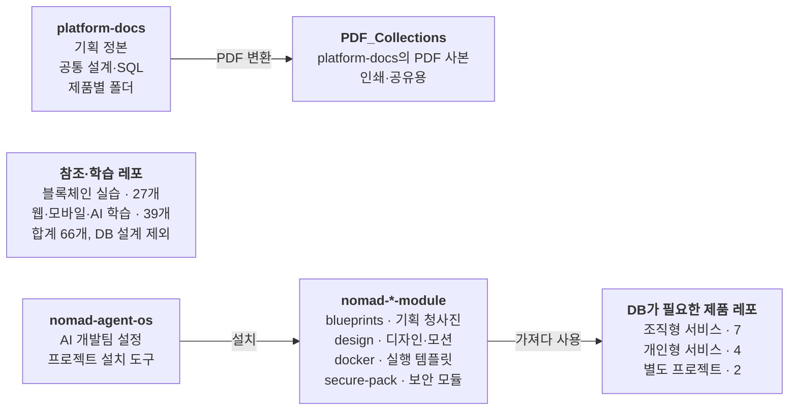

# 문서 · 공통 모듈 · 참조 레포

- DB 없이 GitHub 저장소와 로컬 폴더로 관리
- 제품 레포가 필요할 때 가져다 쓰는 자산

| 항목 | 값 |
|---|---|
| slug | `docs` |
| 유형 | `local` |
| DB | 없음 |

## 구성

## 운영 방식

- 독립 배포나 DB가 필요한 앱인지는 용도별로 판단
- 학습 레포 66개는 DB 설계 대상에서 제외

> 이 문서는 제안 초안입니다. 실제 레포 스키마와 대조 후 확정하세요.
