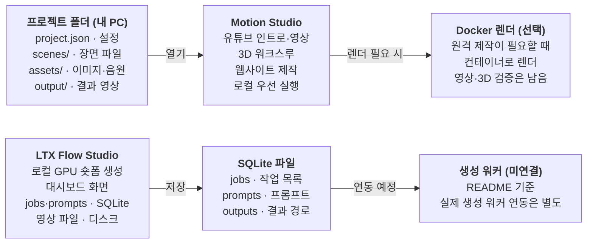

# Motion Studio · LTX Flow Studio · 로컬

- 계정·조직이 없는 개인 도구 · Supabase 불필요
- README 기준으로 정리한 구성

| 항목 | 값 |
|---|---|
| slug | `motion` |
| 유형 | `local` |
| DB | 없음 |

## 구성

## 운영 방식

- 내 PC 폴더와 SQLite 파일로 동작 · 로그인과 조직이 필요 없음
- 판매·구독 서비스로 바뀌면 SceneFlow(조직형) DB와 연결하는 방안을 검토

> 이 문서는 제안 초안입니다. 실제 레포 스키마와 대조 후 확정하세요.
