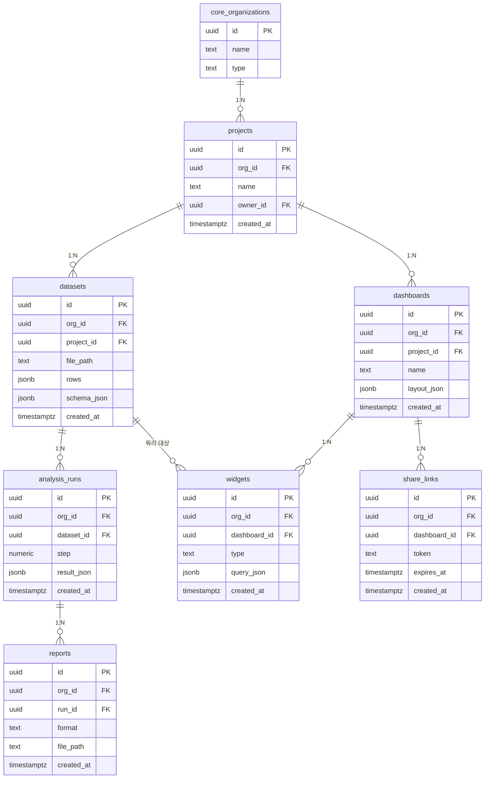

# analytics · 조직형

- tenant = 데이터를 함께 분석하는 팀
- CSV·엑셀 → 7단계 분석 → 대시보드 → 리포트

| 항목 | 값 |
|---|---|
| slug | `analytics` |
| 유형 | `org` |
| DB | Supabase 프로젝트 A |

## ER 다이어그램

## 테이블

| 테이블 | 컬럼 수 |
|---|---|
| `projects` | 5 |
| `datasets` | 7 |
| `analysis_runs` | 6 |
| `dashboards` | 6 |
| `widgets` | 6 |
| `reports` | 6 |
| `share_links` | 6 |

초안 SQL: [`schema.draft.sql`](./schema.draft.sql)

## 역할별 화면

- admin  데이터셋·대시보드 전체와 공유 링크 관리
- analyst  데이터 업로드, 분석 실행, 대시보드 편집
- viewer  공유된 대시보드와 리포트만 열람
- 조직 밖 공유는 share_links 토큰으로만 허용
- RLS: org_id가 내가 속한 조직인 행만 읽고 씀

> 이 문서는 제안 초안입니다. 실제 레포 스키마와 대조 후 확정하세요.
