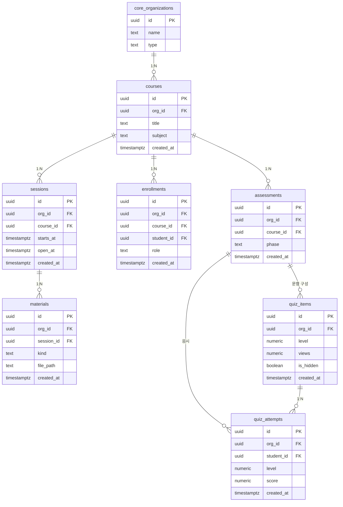

# classroom · 조직형

- tenant = 교육기관·강사 팀
- 시간별 자료 공개, 사전·사후 평가, 3면도 퀴즈

| 항목 | 값 |
|---|---|
| slug | `classroom` |
| 유형 | `org` |
| DB | Supabase 프로젝트 A |

## ER 다이어그램

## 테이블

| 테이블 | 컬럼 수 |
|---|---|
| `courses` | 5 |
| `sessions` | 6 |
| `materials` | 6 |
| `enrollments` | 6 |
| `assessments` | 5 |
| `quiz_items` | 6 |
| `quiz_attempts` | 6 |

초안 SQL: [`schema.draft.sql`](./schema.draft.sql)

## 역할별 화면

- owner  기관 대표: 강의·강사·수강생 전체 관리
- instructor  자료 공개 시각 설정, 평가·성적 확인
- student  내 강의 자료와 내 성적만 열람
- 3면도 퀴즈: 단계별 70% 이상이면 다음 단계, 만점이면 히든 문제 개방
- RLS: org_id + 수강생은 본인 응시 기록만

> 이 문서는 제안 초안입니다. 실제 레포 스키마와 대조 후 확정하세요.
