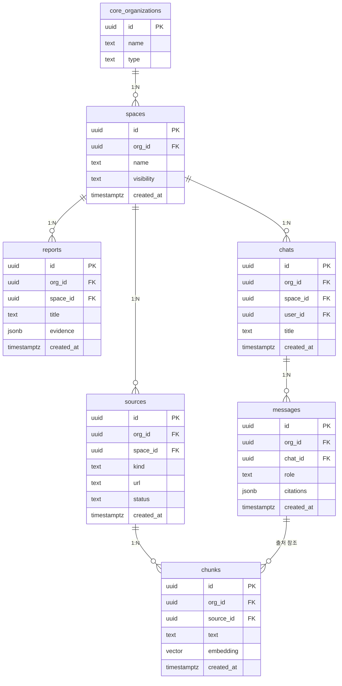

# knowflow · 조직형

- tenant = 자료를 함께 모으고 묻는 팀
- 답변과 리포트마다 출처를 연결

| 항목 | 값 |
|---|---|
| slug | `knowflow` |
| 유형 | `org` |
| DB | Supabase 프로젝트 A |

## ER 다이어그램

## 테이블

| 테이블 | 컬럼 수 |
|---|---|
| `spaces` | 5 |
| `sources` | 7 |
| `chunks` | 6 |
| `reports` | 6 |
| `chats` | 6 |
| `messages` | 6 |

초안 SQL: [`schema.draft.sql`](./schema.draft.sql)

## 역할별 화면

- admin  팀 자료 공간과 공개 범위 관리
- member  자료 추가, 질의응답, 리포트 생성
- viewer  공개된 리포트만 열람
- 벡터 검색도 org_id로 먼저 거른 뒤 수행
- RLS: org_id가 내가 속한 조직인 행만 읽고 씀

> 이 문서는 제안 초안입니다. 실제 레포 스키마와 대조 후 확정하세요.
