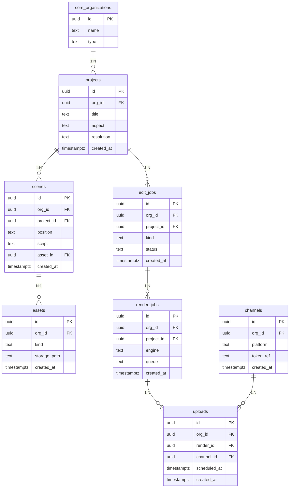

# sceneflow · 조직형

- tenant = 영상 채널을 함께 운영하는 팀
- 스토리보드 → AI 자동편집 → FFmpeg 렌더 → 다채널 업로드

| 항목 | 값 |
|---|---|
| slug | `sceneflow` |
| 유형 | `org` |
| DB | Supabase 프로젝트 A |

## ER 다이어그램

## 테이블

| 테이블 | 컬럼 수 |
|---|---|
| `projects` | 6 |
| `scenes` | 7 |
| `assets` | 5 |
| `edit_jobs` | 6 |
| `render_jobs` | 6 |
| `uploads` | 6 |
| `channels` | 5 |

초안 SQL: [`schema.draft.sql`](./schema.draft.sql)

## 역할별 화면

- admin  채널 연결, 크레딧, 팀원 관리
- editor  스토리보드 편집과 렌더 실행
- uploader  승인된 영상만 채널에 예약 발행
- 렌더 비용은 core.credit_ledger에서 차감 · 채널 토큰은 암호화 보관
- RLS: org_id가 내가 속한 조직인 행만 읽고 씀

> 이 문서는 제안 초안입니다. 실제 레포 스키마와 대조 후 확정하세요.
