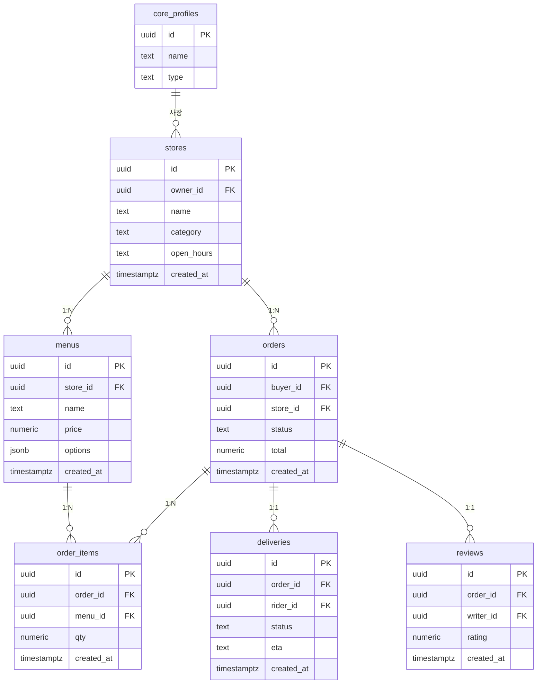

# baedal · 개인형 (마켓플레이스)

- 고객 · 사장 · 라이더가 한 계정 체계를 공유
- 조직 개념 없음

| 항목 | 값 |
|---|---|
| slug | `baedal` |
| 유형 | `user` |
| DB | Supabase 프로젝트 A |

## ER 다이어그램

## 테이블

| 테이블 | 컬럼 수 |
|---|---|
| `stores` | 6 |
| `menus` | 6 |
| `reviews` | 5 |
| `orders` | 6 |
| `order_items` | 5 |
| `deliveries` | 6 |

초안 SQL: [`schema.draft.sql`](./schema.draft.sql)

## 접근 규칙

- 가게·메뉴: 사장(owner_id)만 수정, 고객은 열람
- 주문: 고객(buyer_id)과 해당 가게 사장만 접근
- 배달: 배정된 라이더(rider_id)만 상태·위치 갱신
- 가게 직원 계정이 필요해지면 stores를 조직(org_id)으로 확장

> 이 문서는 제안 초안입니다. 실제 레포 스키마와 대조 후 확정하세요.
