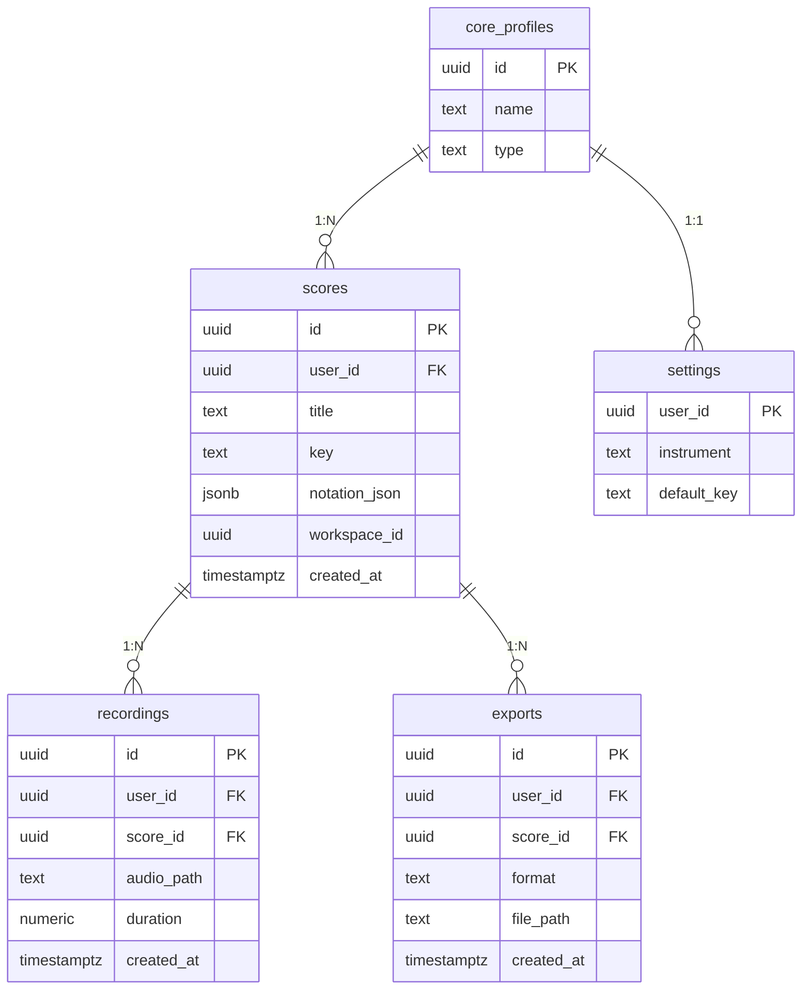

# humscore · 개인형

- 소유자 = 사용자 1명
- 허밍 채보 · 조옮김 · 악보 내보내기

| 항목 | 값 |
|---|---|
| slug | `humscore` |
| 유형 | `user` |
| DB | Supabase 프로젝트 A |

## ER 다이어그램

## 테이블

| 테이블 | 컬럼 수 |
|---|---|
| `scores` | 7 |
| `recordings` | 6 |
| `settings` | 3 |
| `exports` | 6 |

초안 SQL: [`schema.draft.sql`](./schema.draft.sql)

## 접근 규칙

- auth.uid() = user_id 인 행만 읽고 씀 (악보·녹음·설정 모두)
- 교회·팀 공유(예배 콘티)가 생기면 workspace_id를 켜서 조직형으로 전환
- Capacitor 앱도 같은 Supabase 계정을 사용

> 이 문서는 제안 초안입니다. 실제 레포 스키마와 대조 후 확정하세요.
