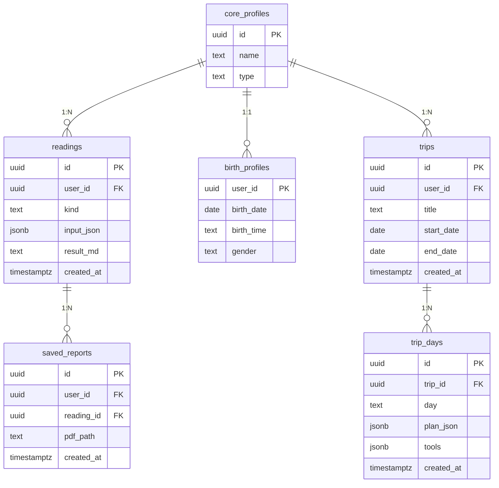

# personal · 개인형 (개인 AI 서비스 묶음)

- 꿈해몽 · 사주·타로(신비로운AI) · 여행일정(SmartAI-RAG-Tour)
- 소유자 = 사용자 1명

| 항목 | 값 |
|---|---|
| slug | `personal` |
| 유형 | `user` |
| DB | Supabase 프로젝트 A |

## ER 다이어그램

## 테이블

| 테이블 | 컬럼 수 |
|---|---|
| `readings` | 6 |
| `saved_reports` | 5 |
| `birth_profiles` | 4 |
| `trips` | 6 |
| `trip_days` | 6 |

초안 SQL: [`schema.draft.sql`](./schema.draft.sql)

## 접근 규칙

- auth.uid() = user_id 인 행만 읽고 씀
- 생년월일·출생시각은 암호화 컬럼 · 규모가 커지면 민감 정보 프로젝트로 분리
- 사주 버티컬(재테크·건강·학습·연애)은 readings.kind 값만 추가

> 이 문서는 제안 초안입니다. 실제 레포 스키마와 대조 후 확정하세요.
