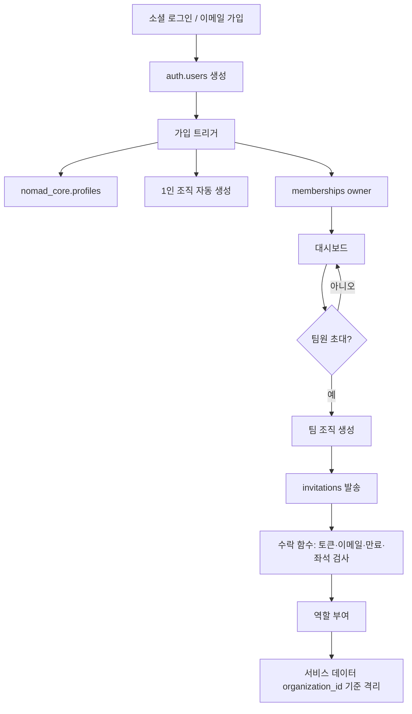

# 가입 · 조직 · 초대 흐름

## 현재 (구현됨)
- 로그인은 Supabase Auth. 조직 생성·멤버 등록은 제품 서버가 service_role로 수행한다(`nomad_core` 쓰기는 서버 전용).
- 접근 판단은 `nomad_core.organization_role(organization_id)`. 비활성 조직·비회원은 null.

## 제안 흐름 (반영 후보, [core-schema](core-schema.md#3-반영-후보))

## 가입 화면
- 카드 2개("개인으로 시작" / "팀·기업으로 시작")는 **UI 선택일 뿐** DB는 동일하다.

## 초대 규칙 (제안)
- 초대는 이메일 기준. 수락 시 로그인 이메일과 일치해야 한다.
- 만료 7일(기본). 만료 후 재발송.
- 좌석 한도는 **초대 시점**에 검사한다 (viewer 제외).
- 계정 공유(1개 ID로 여러 명) 방식은 쓰지 않는다. 사람마다 계정을 가진다.
