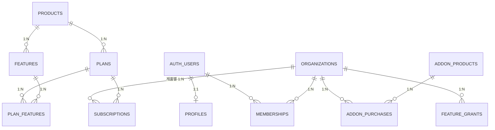

# nomad_core 스키마

모든 서비스가 공유하는 계정·조직·구독 계층. 정본은 `supabase/migrations/20261112000100_nomad_core.sql`이며,
서비스 스키마(`nomad_<slug>`)는 `nomad_core`와 `auth`만 참조한다.

## 1. 현재 테이블 (구현됨)
| 테이블 | 역할 |
|---|---|
| `profiles` | auth.users 1:1 프로필 (`user_id` PK) |
| `products` | 제품 코드 (예: `contentflow_example`) |
| `organizations` | 업체(테넌트). `id`, `name`, `active` |
| `memberships` | 조직-사용자-역할. `organization_id`, `user_id`, `role`(owner·admin·editor·viewer) |
| `platform_admins` | 운영자 권한(operations·billing). 고객 데이터 RLS를 열지 않음 |
| `plans` · `features` · `plan_features` | 제품별 A/B/C 플랜과 포함 기능 |
| `subscriptions` | 조직×제품 구독. `plan_code`, `status`(active·inactive) |
| `addon_products` · `addon_purchases` · `feature_grants` | 단품 판매·구매 원장·기능 이용권 |

모든 `nomad_core` 테이블은 RLS가 켜져 있고 쓰기는 service_role만 한다. 사용자는 아래 함수로만 접근한다.

## 2. 헬퍼 함수 (security definer)
- `nomad_core.organization_role(org uuid) → text` — 활성 조직의 내 역할, 비회원이면 null. RLS 기본 패턴.
- `nomad_core.has_feature(org uuid, product text, feature text) → boolean` — 플랜 또는 단품 이용권으로 기능이 열렸는가.
- `nomad_core.dashboard_features(org uuid, product text)` — 대시보드 기능 카탈로그(`public.nomad_dashboard_features`로 노출).

## 3. 반영 후보
청사진 기획 단계에서 제안됐으나 `nomad_core`에 **없는** 기능. 필요해지면 **새 날짜 마이그레이션**
(`supabase/migrations/YYYYMMDDHHMMSS_*.sql`)으로 추가하고, 이미 적용된 파일은 고치지 않는다.

| 후보 | 제안 내용 | 확인할 것 |
|---|---|---|
| 가입 트리거 | `auth.users` 생성 시 프로필 + 1인 조직 + owner 멤버십 생성 | 기본 구독을 C 플랜으로 줄지, 제품별로 줄지 |
| 조직 유형 | `organizations`에 personal/team 구분 + 팀 조직 생성 함수 | UI 분기만으로 충분한지 |
| `invitations` + 수락 함수 | 이메일 초대, 토큰, 만료 7일, 수락 시 로그인 이메일 일치·좌석 한도 검사(viewer 제외) | 좌석 한도의 기준(제품별 A/B/C 플랜에 좌석 수 추가 여부) |
| `credit_ledger` | 조직 공유 크레딧을 +/- 원장으로 기록, 잔액 뷰, 차감 함수 | 단품(addon)과의 관계: 크레딧 구매를 addon으로 볼지 별도 원장으로 둘지 |

- 제안 SQL의 프로필 공유 정책(같은 조직 멤버끼리 프로필 조회)도 함께 검토한다.
- 크레딧·좌석 수치는 [billing-credits](billing-credits.md)의 "미확정 제안"을 따른다.
