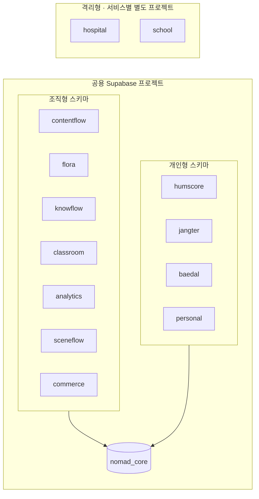

# Supabase 배치

스키마 이름은 모두 `nomad_<slug>`(그림에서는 생략).

## 규칙
1. 서비스 스키마끼리 FK·조인 금지. `nomad_core`·`auth`만 참조.
2. 격리형 프로젝트는 공용 프로젝트와 계정도 분리한다. (병원·학교는 자체 인증)
3. 서비스가 커지면 스키마 단위로 별도 프로젝트로 분리한다. 위 규칙 덕분에 `nomad_core` 참조만 API로 바꾸면 된다.
4. 공용 프로젝트는 Free/Pro로 시작, 격리형은 Pro + 백업 + 감사 로그 전제.

## 비용 관점 (MVP)
- 공용 1개 + 격리형 0개로 시작 가능 (병원·학교는 계약 확정 후 생성)
- 서비스별 프로젝트 대신 스키마 분리로 고정비 절감
